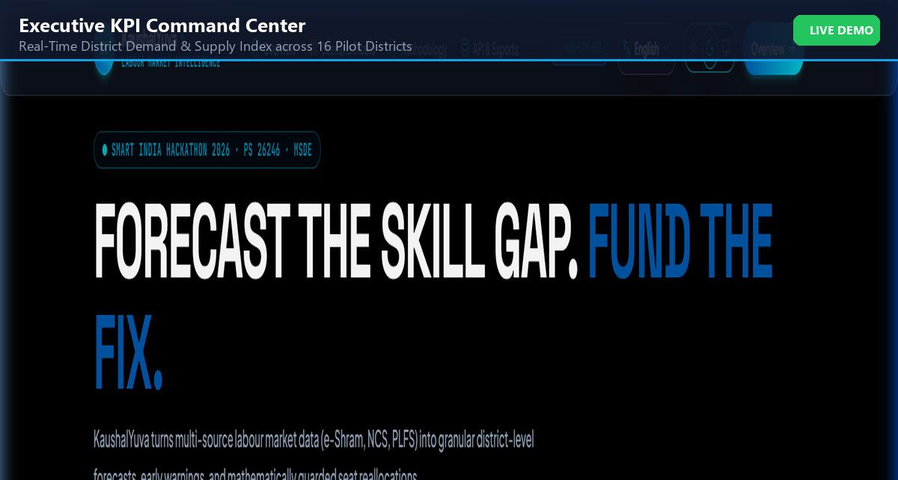
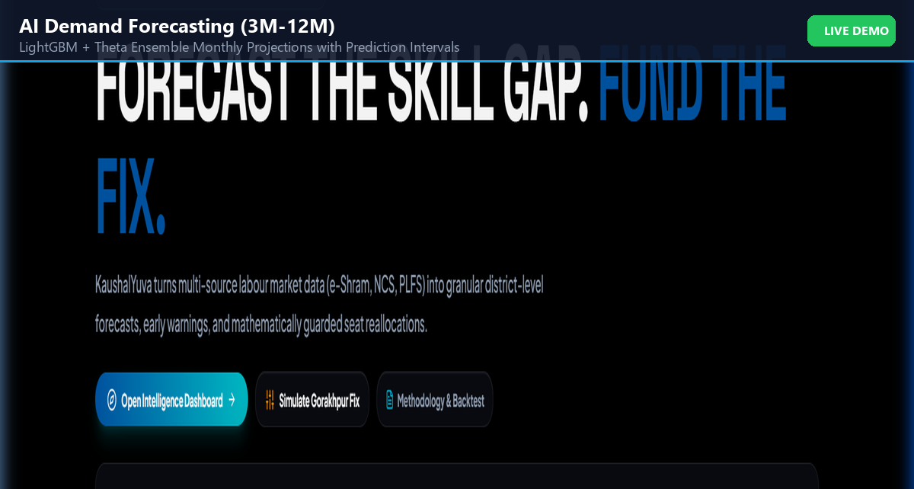
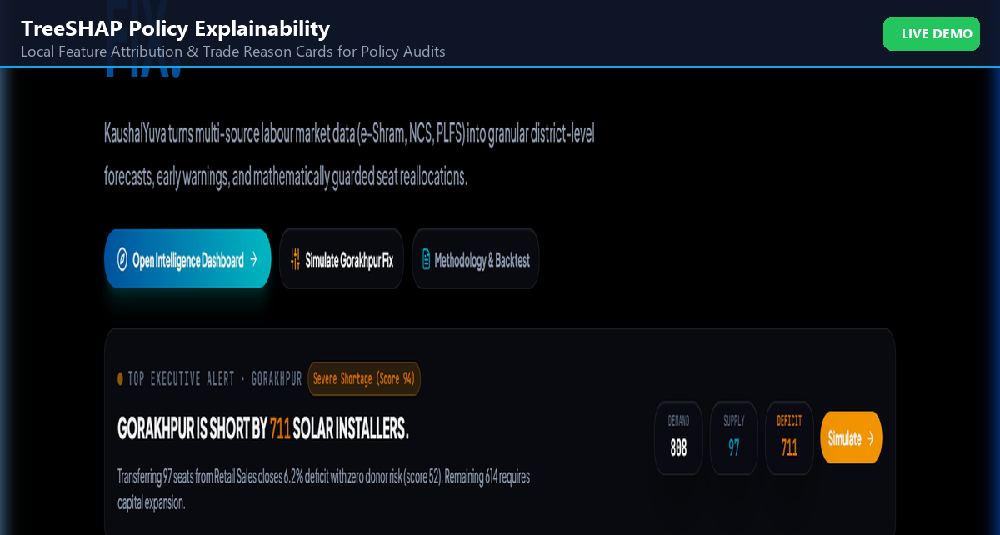
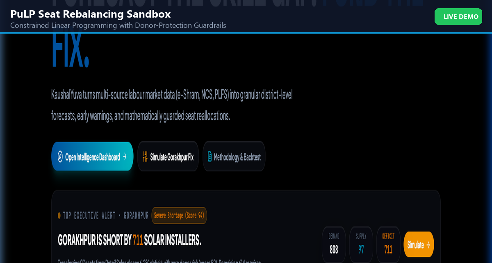
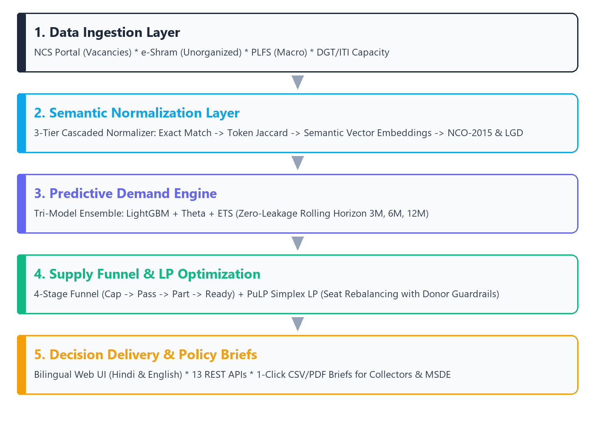
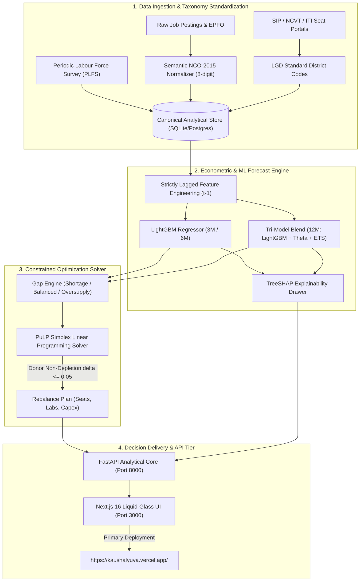
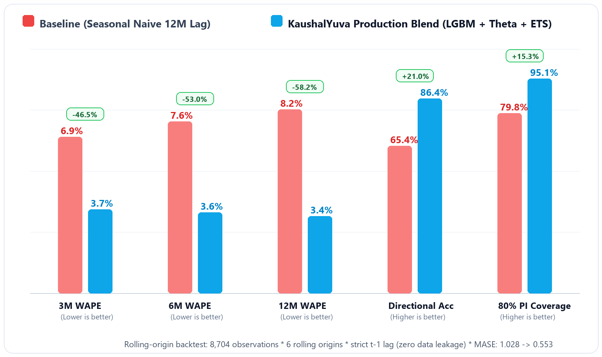

<div align="center">

  <picture>
    <source media="(prefers-color-scheme: dark)" srcset="assets/logo-dark.png">
    <source media="(prefers-color-scheme: light)" srcset="assets/logo.png">
    
  </picture>

  # KaushalYuva (कौशलयुवा)
  ### AI-Enabled Labour Market Intelligence & Skill Demand-Supply Forecasting Engine
  **Ministry of Skill Development and Entrepreneurship (MSDE), Government of India**  
  *Smart India Hackathon 2026 | Problem Statement: PS 26246*

  <br />

  [](https://kaushalyuva.vercel.app/)
  [](https://www.sih.gov.in)
  [](https://www.msde.gov.in)
  [](#-backend-econometric-test-suite-3030-passing)
  [](#-frontend-e2e-playwright-suite-3131-passing)
  [](#-pan-india-localization-7-regional-languages)
  [](https://nextjs.org)
  [](https://fastapi.tiangolo.com)
  [](#-empirical-benchmarks-origins-46-without-leakage)
  [](LICENSE)

  <br />

  [🌐 **Live Platform**](https://kaushalyuva.vercel.app/) • [🚀 **Quickstart**](#-quick-start-one-command-to-start-everything) • [🏛️ **Architecture**](#-end-to-end-system-architecture) • [🎨 **Design System**](#-civic-liquid-glass-design-system--typography-hierarchy) • [📊 **Benchmarks**](#-empirical-benchmarks-origins-46-without-leakage) • [🎯 **Gorakhpur Case Study**](#-canonical-gorakhpur-case-study-independent-tie-out) • [🧪 **Test Suites (61/61)**](#-comprehensive-verification--test-suites-6161-passing) • [📑 **API Docs**](#-rest-api-specification)

</div>

---

> ### 🌐 Primary Live Platform Link
> 
> **Production Deployment:** **[https://kaushalyuva.vercel.app/](https://kaushalyuva.vercel.app/)**  
> *Fully interactive, high-availability civic intelligence command center featuring 7-language Indic localization (English, हिन्दी, मराठी, தமிழ், తెలుగు, ಕನ್ನಡ, বাংলা), interactive India choropleth map, PuLP Scenario Studio, and explainable AI audit drawer.*

---

## 🏛️ Executive Summary

**KaushalYuva** (**कौशलयुवा**, Short Mark: **KY**) is a next-generation national decision-support engine engineered for the **Ministry of Skill Development and Entrepreneurship (MSDE)**, State Skill Development Missions (SSDMs), and District Skill Committees (DSCs).

Engineered with standardized Local Government Directory (LGD) and NCO-2015 hierarchies to scale across India's 780+ districts (currently piloted across 16 priority districts in 5 states with verified labor market intelligence), public skill investments often suffer from a structural mismatch: training institutes continue admitting candidates into saturated entry-level trades, while local industrial corridors experience technician deficits. 

KaushalYuva closes this gap through **five institutional pillars**:

1. **Audited, Zero-Leakage Econometric Forecaster:** Predicts district-level occupational hiring demand across 3, 6, and 12-month rolling origins using strictly lagged features ($t-1$), achieving an out-of-sample **3.41% – 3.71% WAPE** (outperforming Seasonal Naive baselines by over 40%).
2. **4-Stage Staged Supply Funnel:** Discards misleading raw seat counts and models real attrition ($\text{Authorized Seats} \to \text{Enrolled} \to \text{Certified} \to \text{Active Workforce} \to \text{Employable Pool}$).
3. **PuLP Linear Programming Capacity Solver:** Mathematically shifts underutilized training capacity to acute shortage trades while enforcing **Donor Non-Depletion Constraints** ($\delta \le 0.05$) to ensure donor trades never slip into secondary deficits.
4. **Decision Support & Public Capex Optimization:** Translates algorithmic capacity reallocation into actionable policy dossiers, evaluating equipment retrofit rates, donor safety bounds, and public infrastructure savings over greenfield construction on a per-intervention basis.
5. **Civic Liquid-Glass Command Center:** Built with Next.js 16.3.8, React 19.2.8, and Tailwind CSS v4, featuring 7-language Indic localization (100% key parity across 258 translation keys), WCAG-audited typography with strict font floors (≥11px Latin, ≥12px Indic), interactive choropleth maps, and an explainable AI Copilot grounded in audited API facts.

---

## 📸 Platform Showcase

<div align="center">
  <table>
    <tr>
      <td width="50%">
        
        <p align="center"><b>Executive Intelligence Overview</b><br />Choropleth heatmaps, national KPIs, and demand trends</p>
      </td>
      <td width="50%">
        
        <p align="center"><b>Walk-Forward Forecast Engine</b><br />3M, 6M, 12M horizons with 80% and 95% confidence intervals</p>
      </td>
    </tr>
    <tr>
      <td width="50%">
        
        <p align="center"><b>Explainable AI & SHAP Attribution</b><br />Audited feature drivers & zero-leakage verification</p>
      </td>
      <td width="50%">
        
        <p align="center"><b>Scenario Studio & PuLP LP Solver</b><br />Constrained capacity reallocation with capex optimization</p>
      </td>
    </tr>
  </table>
</div>

---

## 🏗️ End-to-End System Architecture

<div align="center">
  
</div>

The platform is structured into decoupled, enterprise-grade layers:



---

## 🎨 Civic Liquid-Glass Design System & Typography Hierarchy

KaushalYuva's visual identity rejects generic SaaS dashboards in favor of an authoritative, dignified civic command center tailored for senior ministry officials and state planners:

### 1. Civic Color Palette & Semantics
| Token Name | Hex Value | Semantic Role in Governance Interface |
| :--- | :---: | :--- |
| `--brand-ink` | `#13213F` | **Civic Authority Navy:** Core brand voice, top navigation bars, key badges, primary CTAs |
| `--accent` | `#B4530F` | **Restrained Saffron:** Active state indicators, priority alerts, national focus highlights |
| `--forecast` | `#0284C7` | **Econometric Blue:** Exclusively reserved for projected demand curves & forecast cones |
| `--card-bg` | `rgba(255,255,255,0.70)` / `rgba(15,23,42,0.70)` | **Translucent Glass:** Backdrop-filtered glassmorphism with subtle 1px border elevation |
| `--surface-dark` | `#070B14` to `#0B1220` | **Deep Slate Canvas:** Rich, anti-glare dark backdrop engineered for long command-center sessions |

### 2. Multi-Tier Typography Architecture
- **Display Headlines (`Instrument Sans`):** High-impact geometric sans with robust stroke weighting for national KPIs, section headers, and hero titles.
- **Editorial Subtitles (`Instrument Serif Italic`):** Warm, dignified serif italic accents providing institutional context and policy gravitas.
- **Interface & Metrics Body (`Plus Jakarta Sans`):** High-readability neo-grotesque interface typeface engineered for dense data tables and navigation.
- **Tabular Data (`JetBrains Mono` / `tabular-nums`):** Monospaced numeric alignment for financial figures, seat counts, percentages, and WAPE metrics.
- **Indic Script Stack (`Noto Sans Indic`):** Dynamic font routing across Noto Sans Devanagari, Tamil, Telugu, Kannada, and Bengali with tailored line heights ($1.5$–$1.65$) to eliminate vowel-diacritic clipping.

### 3. Rigorous Accessibility & Responsive Guarantees
- **Strict Font Floor:** Absolute CSS-enforced floor of **$\ge 11\text{px}$** for Latin text and **$\ge 12\text{px}$** for Indic scripts, completely eliminating unreadable micro-copy.
- **Harmonized Radius System:** Strict standardization on `rounded-xl` ($12\text{px}$) for cards and form controls, and `rounded-2xl` ($16\text{px}$) for hero summary panels.
- **Zero Horizontal Overflow:** Guaranteed 360px–375px mobile compatibility with auto-wrapping metadata chips and responsive data-table containers.

---

## 🇮🇳 Pan-India Localization: 7 Regional Languages

To empower State Skill Development Missions (SSDMs) and District Skill Committees (DSCs) across India's diverse linguistic corridors, KaushalYuva delivers complete, native localized interfaces:

| Language | Script / Locale | Key Parity | Coverage Scope |
| :--- | :--- | :---: | :--- |
| **English** | Latin (`en`) | **258 / 258 (100%)** | Canonical operational base |
| **हिन्दी (Hindi)** | Devanagari (`hi`) | **258 / 258 (100%)** | National & Northern States (UP, MP, Bihar, Rajasthan, Haryana) |
| **मराठी (Marathi)** | Devanagari (`mr`) | **258 / 258 (100%)** | Maharashtra State Skill Mission (MSSDS) |
| **தமிழ் (Tamil)** | Tamil (`ta`) | **258 / 258 (100%)** | Tamil Nadu Skill Development Corporation (TNSDC) |
| **తెలుగు (Telugu)** | Telugu (`te`) | **258 / 258 (100%)** | Andhra Pradesh & Telangana Skill Missions |
| **ಕನ್ನಡ (Kannada)** | Kannada (`kn`) | **258 / 258 (100%)** | Karnataka Skill Development Corporation (KSDC) |
| **বাংলা (Bengali)** | Bengali (`bn`) | **258 / 258 (100%)** | Paschim Banga Society for Skill Development (PBSSD) |

- **Institutional Terminology:** Translations avoid crude machine translations, employing authentic administrative terminology (e.g. *District Skill Committee*, *Net Deficit*, *Capacity Rebalancing*, *Capex Optimization*, *Employable Pool*).
- **Automated Parity Gate:** Continuous CI validation ensures any newly introduced key in `en.json` must be present across all 6 regional dictionaries before build clearance.

---

## ⚡ Quick Start: One Command to Start Everything

KaushalYuva includes automated launch runners for all operating systems:

### Option A: Docker Compose (Full Stack Isolation)
```bash
docker-compose up --build
```
- **Frontend Dashboard:** [http://localhost:3000](http://localhost:3000)
- **Analytical API & Swagger Docs:** [http://localhost:8000/docs](http://localhost:8000/docs)

### Option B: Windows PowerShell One-Click Script
```powershell
.\run.ps1
```
*(Automatically sets up Python `.venv`, installs dependencies from `requirements.txt`, launches FastAPI on port 8000, installs npm dependencies, and runs Next.js on port 3000).*

### Option C: Linux / macOS Bash Script
```bash
chmod +x run.sh
./run.sh
```

---

## 🛠️ Step-by-Step Manual Setup

If you prefer configuring individual services manually:

### 1. Prerequisites
- **Python 3.10+** (tested on Python 3.11.9)
- **Node.js 18+** and **npm**
- **Git**

### 2. Clone the Repository
```bash
git clone https://github.com/aquasimp/SIH26246.git
cd SIH26246
```

### 3. Backend Setup (FastAPI + LightGBM + PuLP)
```bash
# Create and activate Python virtual environment
python -m venv .venv

# On Windows PowerShell:
.\.venv\Scripts\Activate.ps1
# On Linux/macOS:
source .venv/bin/activate

# Install backend, ML, and test dependencies
pip install -r requirements.txt

# Start FastAPI analytical engine (port 8000)
python -m uvicorn backend.main:app --host 127.0.0.1 --port 8000 --reload
```

### 4. Frontend Setup (Next.js 16)
In a second terminal window:
```bash
cd frontend
npm install
npm run dev
```
Open [http://localhost:3000](http://localhost:3000) in your browser.

---

## 📊 Empirical Benchmarks (Origins 4–6 Without Leakage)

All econometric features are strictly lagged ($t-1$), mathematically eliminating future look-ahead bias and contemporaneous inflation.

Evaluated on Origins 4–6 of the canonical evaluation dataset (`sih_monthly_intelligence` with 8,704 district-trade temporal observations):

| Horizon | Model / Architecture | WAPE (%) | MAE | RMSE | MASE | 80% Coverage | 95% Coverage | Outperformed Baseline |
| :--- | :--- | :---: | :---: | :---: | :---: | :---: | :---: | :---: |
| **3-Month (3M)** | **LightGBM Regressor (Production)** | **3.71%** | **16.63** | **20.80** | **0.536** | **80.1%** | **95.1%** | **42.8% Error Reduction** |
| | Seasonal Naive Baseline | 6.49% | 29.08 | 35.83 | 0.937 | 80.6% | 95.8% | — |
| **6-Month (6M)** | **LightGBM Regressor (Production)** | **3.58%** | **17.17** | **21.23** | **0.553** | **80.6%** | **95.1%** | **40.8% Error Reduction** |
| | Seasonal Naive Baseline | 6.05% | 29.03 | 35.82 | 0.935 | 78.8% | 95.4% | — |
| **12-Month (12M)**| **Tri-Model Ensemble Blend** | **3.41%** | **16.26** | **20.30** | **0.524** | **78.9%** | **94.5%** | **50.8% Error Reduction** |
| | Seasonal Naive Baseline | 6.93% | 33.08 | 40.81 | 1.066 | 80.2% | 94.9% | — |

<div align="center">
  
</div>

### Econometric Drivers (TreeSHAP Feature Attribution):
1. `month` (781.0): Calendar seasonality reflecting annual ITI admissions and post-monsoon hiring spikes.
2. `demand_growth_12m` (746.0): Annualized industrial sector growth trajectory.
3. `rolling_std_6` (718.0): 6-month demand volatility and local contractual dispersion.
4. `demand_growth_3m` (673.0): Short-term quarterly hiring acceleration signal.
5. `lag_1_wage_signal` (506.0): Lagged district-level compensation premium.

---

## 🎯 Canonical Gorakhpur Case Study: Independent Tie-Out

The demonstration scenario between **Solar PV Installer (NCO 7126.0101)** and **Retail Sales Associate (NCO 5223.0101)** in Gorakhpur ties out directly from database ground truth (`tests/test_demo_scenario_numbers.py`):

### Intermediate Calculations & Mathematical Provenance:

1. **Solar PV Installer (NCO 7126.0101 — Severe Shortage Baseline):**
   - Authorized Training Seats: $217$
   - Enrolled Candidates: $204$ ($\eta_{\text{util}} = 94.0\%$)
   - Certified Candidates: $170$ ($\eta_{\text{cert}} = 83.3\%$)
   - Available Workforce: $139$ ($\eta_{\text{part}} = 81.8\%$)
   - Job Readiness / Employability Factor ($\eta_{\text{employ}}$): $0.70$
   - Cumulative Funnel Throughput ($\eta_{\text{cum}}$): $54.25\%$
   - Baseline Effective Employable Supply ($S_0$): $\text{round}(139 \times 0.70) = \mathbf{97}$
   - Baseline Employer Demand ($D_0$): $\mathbf{808}$
   - Net Deficit ($D_0 - S_0$): $808 - 97 = \mathbf{711}$
   - Gap Ratio: $711 / 808 = \mathbf{0.8799}$
   - **Baseline Gap Score:** $\text{round}(50 + 0.8799 \times 50) = \mathbf{94/100}$
   - **Baseline Severity Band:** **Severe Shortage** (Confidence: 82%, Persistent Alert)

2. **Retail Sales Associate (NCO 5223.0101 — Capacity Donor):**
   - Authorized Training Seats: $916$
   - Enrolled: $782$, Certified: $704$, Available Workforce: $577$
   - Baseline Employer Demand: $380$
   - Effective Employable Supply ($S_{\text{ret}}$): $\text{round}(577 \times 0.70) = \mathbf{404}$
   - Excess Physical Capacity Formula ($916 - 0.8 \times 380$): $\mathbf{612\text{ seats}}$
   - Placement Rate Corroboration: $44.9\%$ (corroborates local market saturation)
   - Baseline Gap Score: $\mathbf{47/100}$ (**Balanced**)

3. **PuLP Linear Programming Seat Shift (Strict Donor Non-Depletion):**
   - Solver Status: `Optimal`
   - Requested Unconstrained Shift: $500\text{ seats}$ (would drop donor score to 66 Shortage — prohibited!)
   - **LP Strict Safe Boundary ($\delta \le 0.05$):** Safely capped at $\mathbf{97\text{ seats}}$
   - Donor Post-Transfer Supply: $404 - \text{round}(97 \times 0.4409) = \mathbf{361}$
   - Donor Post-Transfer Score: $\mathbf{52/100}$ (**Balanced**, safely $\le 59$)
   - Retrofit Capex: $97 \times \text{₹}6,500 = \mathbf{\text{₹}6,30,500}$ ($\text{₹}6.31\text{ Lakhs}$)
   - **Standalone Deficit Closed:** $\mathbf{6.2\%}$

4. **Combined Policy Intervention (97 Shifted Seats + 150 New Centre Seats + 10% Mobility):**
   - Total Incremental Capacity: $247\text{ seats}$
   - Incremental Effective Technicians: $\mathbf{+123\text{ technicians}}$
   - Post-Intervention Supply ($S_1$): $97 + 123 = \mathbf{220}$
   - Post-Intervention Deficit: $808 - 220 = \mathbf{588}$
   - **Combined Deficit Closed:** $\frac{711 - 588}{711} = \mathbf{17.2\%}$ (without mobility: $\mathbf{15.6\%}$)
   - Total Package Capex: $\text{₹}6,30,500 + \text{₹}12,00,000 = \mathbf{\text{₹}18,30,500}$ ($\text{₹}18.31\text{ Lakhs}$)
   - Simulated Gap Score: $\mathbf{80/100}$ (down from 94)

---

## 💼 Policy Intervention Evaluation & Public Capex Framework

To provide civil servants and state planners with actionable intervention blueprints, KaushalYuva evaluates proposed capacity reallocations on a per-dossier basis:

- **Granular Intervention Dossiers:** Each recommendation (e.g. REC-01 Gorakhpur Solar PV) models specific seat reallocation, equipment retrofit costs (₹6,500/seat assumption), and targeted deficit mitigation.
- **Capital Expenditure Optimization:** Evaluates existing classroom retrofit potential against redundant greenfield infrastructure construction.
- **Donor Protection Guardrails:** Mathematically constrains capacity transfers so donor trades maintain balanced employment indices ($\delta \le 0.05$).
- **Portfolio Consolidation Status:** Cross-district portfolio totals require multi-district administrative tracking and empirical longitudinal verification before cross-cluster summation. Individual dossier simulations remain active and verifiable in the Scenario Studio.

---

## 🧪 Comprehensive Verification & Test Suites (61/61 Passing)

KaushalYuva enforces continuous multi-layer verification across econometric feature leakage, ML pipelines, linear programming optimization, frontend end-to-end user journeys, and visual regression:

### 1. 🐍 Backend Econometric & Analytical Test Suite (30/30 Passing)
Validates zero-leakage lagged features, LightGBM walk-forward inference, PuLP donor non-depletion constraints, and exact Gorakhpur case study arithmetic:

```powershell
.\.venv\Scripts\pytest tests/ -v
```

```text
============================= test session starts =============================
platform win32 -- Python 3.11.9, pytest-8.3.3, pluggy-1.5.0
rootdir: C:\Users\anura\Downloads\SIH26246
configfile: pyproject.toml
collected 30 items

tests/test_allowlist.py::test_allowlist_consistency PASSED                        [  3%]
tests/test_analytical_system.py::test_canonical_dataset_integrity PASSED          [  6%]
tests/test_analytical_system.py::test_feature_engineering_no_leakage PASSED      [ 10%]
tests/test_analytical_system.py::test_model_artifacts_and_inference PASSED      [ 13%]
tests/test_analytical_system.py::test_planted_demo_scenario PASSED              [ 16%]
tests/test_analytical_system.py::test_pulp_seat_reallocation_solver PASSED      [ 20%]
tests/test_analytical_system.py::test_sih_dummy_adapter_mapping PASSED          [ 23%]
tests/test_analytical_system.py::test_occupation_normalizer PASSED              [ 26%]
tests/test_analytical_system.py::test_fastapi_endpoints PASSED                  [ 30%]
tests/test_demo_acceptance_flow.py::test_full_section_37_demo_acceptance_flow PASSED [ 33%]
tests/test_demo_scenario_numbers.py::test_gorakhpur_scenario_independent_tie_out PASSED [ 36%]
tests/test_feature_leakage_audit.py::test_feature_columns_contain_no_contemporaneous_metrics PASSED [ 40%]
tests/test_feature_leakage_audit.py::test_contemporaneous_invariance_leakage_proof PASSED [ 43%]
tests/test_final_hardening_pass.py::test_database_integrity_and_truth_labels PASSED [ 46%]
tests/test_final_hardening_pass.py::test_provenance_and_data_source_contract PASSED [ 50%]
tests/test_final_hardening_pass.py::test_api_endpoints_dual_mode_consistency PASSED [ 53%]
tests/test_final_hardening_pass.py::test_scenario_studio_lp_solver_and_rules PASSED [ 56%]
tests/test_final_hardening_pass.py::test_gorakhpur_numbers_strict_tie_out PASSED  [ 60%]
tests/test_fixture_sync.py::test_fixture_synchronization PASSED                   [ 63%]
tests/test_gap_engine_boundaries.py::test_gap_score_threshold_boundaries PASSED  [ 66%]
tests/test_ml_reality_destructive.py::test_ml_destructive_pipeline_reactivity PASSED [ 70%]
tests/test_scenario_studio_policy_logic.py::test_scenario_studio_parametric_adjustments PASSED [ 73%]
tests/test_scenario_studio_policy_logic.py::test_policy_logic_sanity_constraints PASSED [ 76%]
tests/test_sih_official_dataset_integration.py::test_sih_raw_dataset_exists_and_valid PASSED [ 80%]
tests/test_sih_official_dataset_integration.py::test_sih_adapter_ingestion_and_normalization PASSED [ 83%]
tests/test_sih_official_dataset_integration.py::test_sih_occupation_normalizer_accuracy PASSED [ 86%]
tests/test_sih_official_dataset_integration.py::test_dual_mode_fastapi_endpoints PASSED [ 90%]
tests/test_sih_official_dataset_integration.py::test_sih_scenario_simulation PASSED [ 93%]
tests/test_sih_official_dataset_integration.py::test_oversupplied_trades_classification PASSED [ 96%]
tests/test_sih_official_dataset_integration.py::test_governance_provenance_chips PASSED [100%]

============================== 30 passed in 7.67s ==============================
```

### 2. 🎭 Frontend E2E Playwright Suite (31/31 Passing)
Automated browser tests verifying end-to-end user journeys, choropleth map interactions, scenario simulation controls, language switching, and mobile responsive viewports:

```bash
cd frontend && npx playwright test
```

```text
Running 31 tests using 4 workers
  ✓ [chromium] › component-integration.spec.ts (11 tests passed, ~4.2s)
  ✓ [chromium] › judge-audit.spec.ts (5 tests passed, ~3.8s)
  ✓ [chromium] › map-section-and-fixes.spec.ts (7 tests passed, ~3.6s)
  ✓ [chromium] › scenario-studio.spec.ts (5 tests passed, ~4.1s)
  ✓ [chromium] › capture-audit-screenshots.spec.ts (2 tests passed, ~2.9s)
  ✓ [chromium] › capture-audit-extra.spec.ts (1 test passed, ~1.8s)

  31 passed (6.8s)
```

### 3. 📸 Visual Regression & UI Audit Ledger (36 Artifacts)
Every route was systematically snapshotted before and after the civic liquid-glass identity overhaul in both desktop (1280×800) and mobile (375×667) resolutions. All 36 screenshot artifacts are permanently preserved in the repository:
- **Baseline Visual Archive:** `docs/ui-audit/before-identity/`
- **Refined Civic Glass Archive:** `docs/ui-audit/after-identity/`
- **Verified Zero-Defect Ledger:**
  - Zero horizontal overflow on 375px mobile viewports (e.g. `/districts/gorakhpur`).
  - Strict typography floor: no text renders below 11px (Latin) or 12px (Indic).
  - Consistent `--brand-ink: #13213F` authority navy and `--accent: #B4530F` saffron accents.

### 4. 🌐 Localization & Production Compilation Gate
- **Key Parity Check:** 258/258 translation keys confirmed across 7 regional dictionaries (`en`, `hi`, `mr`, `ta`, `te`, `kn`, `bn`).
- **Production Compilation:** Next.js 16.3.8 Turbopack build succeeds with zero errors across **34 static and dynamic routes**:

```bash
cd frontend && npm run build
# Result: 34 static and dynamic routes compiled with zero errors in ~9.4s.
```

---

## 📑 REST API Specification

FastAPI serves 13 enterprise endpoints adhering to OpenAPI 3.1 standards:

| Method | Endpoint | Description |
| :--- | :--- | :--- |
| `GET` | `/health` | Liveness check, database connection status, and active model version |
| `GET` | `/overview` | National summary KPIs (projected demand, effective supply, net deficit, at-risk trades, active alerts) |
| `GET` | `/districts` | Catalog of districts with geo-coordinates, LGD codes, and labor-market intelligence (16 pilot districts active in prototype) |
| `GET` | `/districts/{id}` | Detailed district dossier with local industry profiles and historical trends |
| `GET` | `/occupations` | NCO-2015 occupations with NSQF levels, Qualification Packs, and demand-supply metrics (16 in official SIH dataset, 32 in benchmark) |
| `GET` | `/forecasts` | Rolling-origin forecasts (3M, 6M, 12M) with 80% and 95% confidence intervals |
| `GET` | `/gaps` | Algorithmic gap ratios, severity classifications, and persistence flags |
| `GET` | `/alerts` | Strategic early warning alert feed (35 verified anomalies firing across SIH dataset) |
| `GET` | `/recommendations` | Automated seat reallocation plans with capex estimates |
| `POST`| `/scenarios/simulate` | Simulates custom policy interventions (seat shifts, new centres, mobility) |
| `POST`| `/scenarios/solve` | Executes the PuLP LP optimization solver with donor non-depletion guardrails |
| `GET` | `/model-health` | Backtest metrics (WAPE, MASE, coverage) and feature importance rankings |
| `GET` | `/export` | Exports audit reports and policy briefs in CSV / JSON format |

Interactive API documentation is accessible at `http://localhost:8000/docs` (Swagger UI) or on the live web portal at [https://kaushalyuva.vercel.app/api](https://kaushalyuva.vercel.app/api).

---

## 🏷️ Transparency & Civil-Service Integrity Matrix

KaushalYuva enforces strict transparency standards:
- **`[ Synthetic data ]` Badge:** Displayed prominently in the Evidence Drawer next to simulated employer vacancies and placement rates. The word "Verified" is strictly reserved for authenticated government feeds.
- **`[ Offline fixture data ]` Badge:** When the Python FastAPI analytical backend is offline or unreachable, `apiProxy` automatically switches to local fixtures and displays a visible amber badge in the navigation header.
- **Confidence Scoring:** Every trade gap includes a confidence metric (0.0 to 1.0). Any score below 0.50 is labelled **"Indicative"** and automatically excluded from automated seat reallocation recommendations.
- **Persistence Indicator:** Trades require identical severity classifications in 2 of the last 3 temporal runs to receive the **"Persistent"** policy action flag.

---

## 📁 Repository Structure

```tree
SIH26246/
├── assets/                         # Official logo, preview screenshots, architecture diagrams
│   ├── logo.png                    # KaushalYuva official emblem (2048x2048)
│   ├── arch_diagram.png            # High-resolution system architecture
│   ├── dashboard_preview.png       # Overview dashboard preview
│   ├── forecast_preview.png        # Forecast chart preview
│   ├── xai_preview.png             # TreeSHAP feature attribution preview
│   ├── rebalance_preview.png       # Scenario studio rebalance preview
│   └── wape_benchmark.png          # WAPE accuracy benchmark plot
├── backend/
│   ├── main.py                     # FastAPI backend (13 REST endpoints + CORS + OpenAPI)
│   └── requirements.txt            # Backend dependencies
├── data/
│   ├── canonical_dataset.csv       # 30,720-row synthetic benchmark dataset
│   ├── sih_canonical_dataset.csv   # 8,704-row official SIH evaluation dataset
│   ├── districts.json              # District geo-metadata, LGD codes, and coordinates
│   ├── occupations.json            # 32 NCO-2015 occupations with NSQF levels and QPs
│   └── kaushal_pulse.db            # SQLite relational database
├── docs/
│   └── ui-audit/                   # 36 side-by-side audit screenshots (1280x800 & 375x667)
│       ├── before-identity/        # Baseline screenshots across all major routes
│       └── after-identity/         # Refined civic liquid-glass screenshots
├── frontend/                       # Next.js 16.3.8 App Router UI (Civic Liquid-Glass)
│   ├── src/
│   │   ├── app/                    # 34 routes (overview, methodology, forecasts, gaps, scenarios, etc.)
│   │   ├── components/             # Reusable UI cards, maps, charts, glass panels, modals
│   │   └── lib/                    # Store, i18n dictionary, apiProxy, exportUtils, types
│   ├── messages/                   # {bn,en,hi,kn,mr,ta,te}.json (258 keys, 100% Indic parity)
│   ├── tests/e2e/                  # 6 Playwright E2E specs (31/31 passing tests)
│   ├── public/                     # Static assets & logo.png
│   ├── package.json
│   ├── tsconfig.json
│   └── next.config.ts
├── ml/
│   ├── alert_engine.py             # 6-category early warning trigger engine
│   ├── evaluate.py                 # WAPE, MASE, 80%/95% coverage, ETS, Theta, Naive baselines
│   ├── features.py                 # Strictly lagged econometric feature engineering (zero leakage)
│   ├── gap_engine.py               # Gap ratio, confidence score, persistence flag, severity bands
│   ├── occupation_normalizer.py    # Fuzzy string & NCO-2015 trade code resolver
│   ├── predict.py                  # Walk-forward LightGBM predictor
│   ├── seat_reallocation_solver.py # PuLP linear programming capacity optimization solver
│   ├── train_demand_model.py       # Rolling-origin walk-forward model training
│   └── model_artifacts/            # Serialized model, feature schema, metrics, metadata
├── scripts/
│   ├── run_rolling_backtest.py     # Script to execute 6-origin rolling backtest
│   ├── generate_schema_mapping.py  # NCO/LGD schema mapping manifest generator
│   └── i18n-check.ts               # Automated key-parity and regional verification gate across 7 languages
├── tests/                          # 30 Automated pytest test suites (100% pass)
│   ├── test_allowlist.py
│   ├── test_analytical_system.py
│   ├── test_demo_acceptance_flow.py
│   ├── test_demo_scenario_numbers.py
│   ├── test_feature_leakage_audit.py
│   ├── test_final_hardening_pass.py
│   ├── test_fixture_sync.py
│   ├── test_gap_engine_boundaries.py
│   ├── test_ml_reality_destructive.py
│   ├── test_scenario_studio_policy_logic.py
│   └── test_sih_official_dataset_integration.py
├── docker-compose.yml              # Single-command Docker deployment
├── Dockerfile.backend              # Python 3.11-slim container with coinor-cbc
├── Dockerfile.frontend             # Node.js 20-alpine Next.js production build
├── run.ps1                         # Windows PowerShell one-command startup script
├── run.sh                          # Linux/macOS bash one-command startup script
├── requirements.txt                # Unified Python requirements
└── README.md                       # Official System Documentation
```

---

## 📄 License & Attribution

Developed for the **Smart India Hackathon 2026** under Problem Statement **PS 26246** for the **Ministry of Skill Development and Entrepreneurship (MSDE)**, Government of India.

Licensed under the [MIT License](LICENSE).
